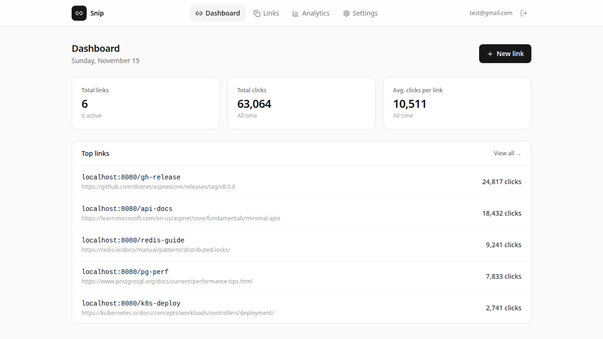
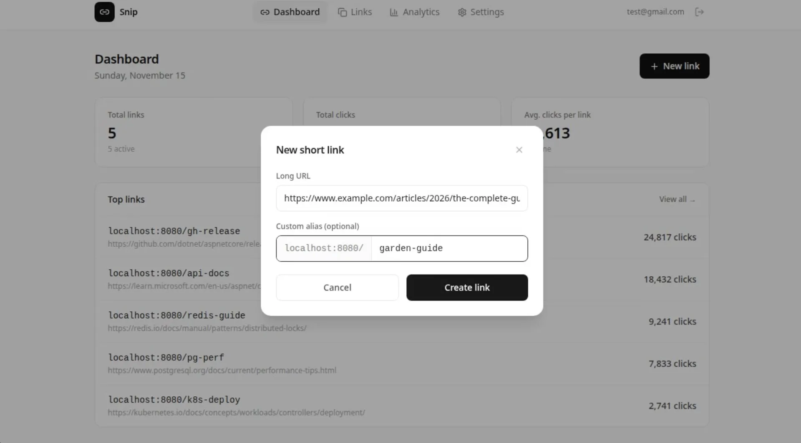
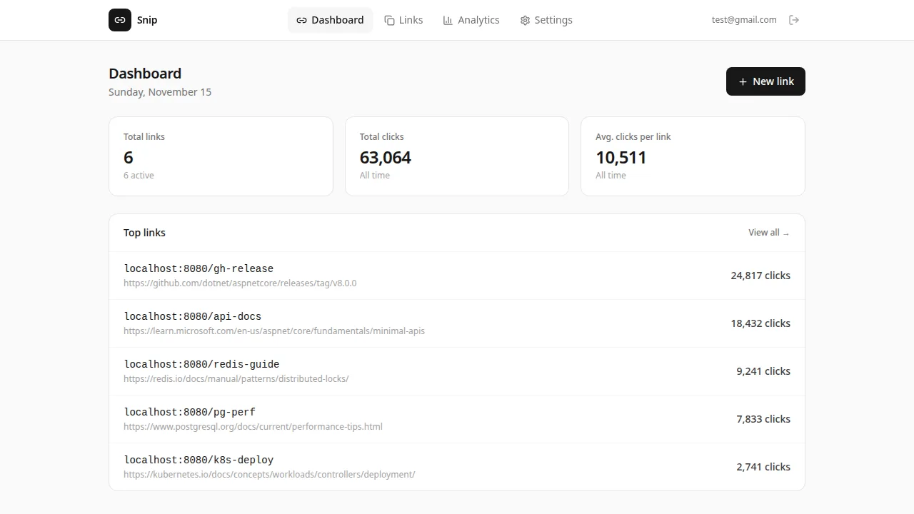

# Snip - URL Shortener

A minimal, clean demo of a URL shortener. Shorten links, track clicks, and
browse simple analytics.


## Walkthrough

[▶ Watch the walkthrough (29s)](docs/walkthrough.mp4) - sign in with the demo account, shorten a long URL, and tour the dashboard, links, and analytics.

[](docs/walkthrough.mp4)

## Demo login

The login form is pre-filled with the demo account - just hit **Sign in**:

- Email: `test@gmail.com`
- Password: `test`

## Running the full stack

The frontend talks to the real backend API - login, links, and analytics are
all live data, not mocks. Start the backend first, then the frontend:

```bash
# 1. Backend (requires .NET 8 SDK and Docker)
cd backend
docker compose up -d   # PostgreSQL + Redis
dotnet run --project src/Snip.Api   # API on http://localhost:8080

# 2. Frontend (in a second terminal, from the repo root)
npm i
npm run dev   # UI on http://localhost:5173
```

The Vite dev server proxies the UI's `/api/...` calls to the API on port
8080 (see `vite.config.ts`), so no CORS setup is needed for local dev; the
API also sends permissive CORS headers for other origins.

## Backend (`backend/`)

A real ASP.NET Core 8 API lives in `backend/`: JWT authentication, link
management, Redis cache-aside redirects, and async click analytics backed by
PostgreSQL. See [backend/README.md](backend/README.md) for the architecture
and run instructions, and [backend/BENCHMARK.md](backend/BENCHMARK.md) for
the measured Redis-vs-Postgres redirect latency (~75% lower mean latency
under concurrent load).

The backend seeds the demo account (`test@gmail.com` / `test`).

## Portfolio media

The [case study on jaelyncuellar.com](https://jaelyncuellar.com/projects/url-shortener) uses web versions of the cover and walkthrough poster above. Those exact files are kept here so the GitHub and portfolio visuals match. The walkthrough video itself is already the same file in both places: `docs/walkthrough.mp4`.




